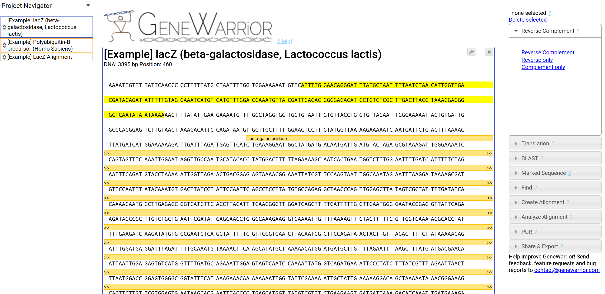

# [GeneWarrior](http://genewarrior.com)



## What is it about

GeneWarrior is an online DNA and protein sequence manipulation tool to perform common tasks such as managing sequences,
calculating the reverse complement of a sequence, translating nucleotide to protein sequences, creating alignments,
sequence logos, phylogenetic trees and designing PCR primers.

It's designed to be very accessible (basically: paste your sequences into the website, do your manipulations, copy the
result from the website), perform the common actions with a few clicks and be done within seconds, and this with a
(hopefully)
clear user interface.

## What does it do?

GeneWarrior is hosted on [GeneWarrior.com](http://genewarrior.com), try it out.

Take a look at the tutorial video
on [how to design PCR primers with GeneWarrior on Youtube](https://www.youtube.com/watch?v=Tt5Lo7cTSK0).

There are a couple of tutorials available on how to perform the important
actions [here](http://genewarrior.com/docs/index.jsp),
such
as [designing PCR primers](http://genewarrior.com/docs/tut_primerdesign.jsp), [get the reverse complement sequence](http://genewarrior.com/docs/tut_revcomp.jsp),
[translate DNA into amino acid sequences](http://genewarrior.com/docs/tut_translation.jsp), [align sequences](http://genewarrior.com/docs/tut_createalignment.jsp),
and [creating consensus sequences, phylogenetic trees and sequence logos from alignments](http://genewarrior.com/docs/tut_analyzealignment.jsp).

## Technical and Historical Background

GeneWarrior was developed in 2014-2015 heavily relying on tech stacks that were fancy back than:
the backend was based on Java Servlets and Java Servlet Pages, the front end on jQuery.

The application is hosted from the beginning on a small DigitalOcean droplet where it does its job faithfully
since approx. 9 years and running. I (and judging from the web analytics a handful of other users) have
been relying on it for basic day-to-day needs that occur in a biotech company, e.g.
for quickly comparing a couple of sequence, translate DNA sequences to proteins etc.

In early 2023, I finally got around to opensource the code. I did some very basic and superficial modernization,
which consists mainly of porting everything from Java Servlets to Spring Boot. The original servlet backend
was handling raw `HttpServletRequest` and `HttpServletResponse` objects, whereas Spring Boot makes the job
much cleaner. Furthermore, database handling for sharing projects now also relies on Spring Boot JPA.

The actual DNA and Protein sequence is handled by a subset of my [GeneTools](https://github.com/r-follador/GeneTools)
library (which is even older, think of it as a self-made BioJava).

### The Good

Judging from the hosted application that is running since years with only minor maintenance,
the app is very stable, reliable and fast on a compute instance with half a GB memory.

Another upside is that the server is completely stateless, state is handled entirely by the client.
So no fancy session management is needed, which would allow easy scalability.

### The Bad and the Ugly

Mainly: code quality represents my state of knowledge from approx. 9 years ago and also the fact
that the code was partially written on the beaches of Indonesia.

Basically there's a single endpoint that receives a JSON request, where the type of action (e.g.
reverse complement or alignment etc.) is defined as a member property. This was convenient with Servlets when handling
raw `HttpServletRequest`s, but the lack of separation makes the code not very nice to read
(also on the frontend).

I have not updated the frontend (which includes -don't laugh- jQuery v1.11), that would definitely
be the next thing on the To Do list. Nowadays pretty much everything where jQuery was required is doable in
plain JavaScript with the same amount of code.

## Modern Workspace Development

The modernization uses Java 25/Spring Boot and a separate Svelte/Vite frontend.
From the repository root, run the backend and frontend in separate terminals:

```bash
GRADLE_USER_HOME=.gradle-home ./gradlew bootRun
npm --prefix frontend ci
npm --prefix frontend run dev
```

Open http://localhost:5173 for the modern workspace. Vite proxies API requests to
Spring on port 8080. Legacy controllers now require an explicit `legacy` profile
and are disabled in production.

### Docker

The first container deployment packages the compiled frontend, Spring API and
offline-tested Primer3/T-Coffee binaries, with PostgreSQL as a separate service:

```sh
sh docker/init-secrets.sh
docker compose up -d --build --wait
```

Open http://localhost:8081. No host Java/Node/scientific tools are required.
T-Coffee alignment jobs are enabled with durable inputs, cancellation and refresh
recovery. Select 2-20 same-kind ungapped sequences, then **Create Alignment > T-Coffee**.
Primer3's design workflow is the next integration step. See [Docker deployment](docker/README.md)
for credentials, persistence, limits, verification, source/licensing inventory and
remaining public-release gates.

The workspace autosaves sequences, alignments, annotations, names and entry ordering
in browser storage. Share project creates a server snapshot and displays its link.
Shared projects use a separate browser draft, so editing one does not overwrite the
local workspace or the published snapshot. Selection and collapsed-card state are
temporary. Browser storage is specific to the origin, so use the same hostname/port
to return to a saved draft.

Local development uses a file-backed H2 database at `data/genewarrior` so shared links
survive backend restarts. Keep that directory to retain local shares. PostgreSQL
remains the persistent deployment database; tests use in-memory H2.

### Exports

Open **Share & Export** in the tools panel. Exports use selected entry cards, or the
entire workspace if none are selected. Choose **All entries** to override selection.
They preserve workspace order and use complete entries, not the selected subsequence.

- **Export FASTA** downloads standalone DNA/protein sequences, wrapped at 70 characters.
- **Export CLUSTAL** downloads an alignment as `.aln`. Multiple alignments are bundled
  in one ZIP with a separate `.aln` for each. Gaps and consensus columns are preserved;
  whitespace in row names becomes underscores and duplicate identifiers get suffixes.
- **Print** opens browser printing (including Save as PDF) with expanded entries,
  annotation arrows, background colors and alignment consensus coloring. It does not
  change selection or collapsed cards. Native browser printing uses the same scope.

FASTA/CLUSTAL do not store workspace annotations; use project sharing to preserve
editable annotations. Export controls are disabled when the scope contains no
applicable entries. Downloads run locally in the browser with sanitized filenames.

### Sequence Logos

Select one or more alignment cards and use **Analyze Alignment > Sequence logo**.
Each logo is inserted below its source. Switch between frequency and information
content in the card; hover a column or letter for counts, coverage and information.
Logos support SVG download, print/PDF, browser autosave and project sharing.

The native Java calculation uses equal sequence weights and a uniform background,
without pseudocounts or small-sample correction. Gaps and ambiguous residues/stops
are excluded from frequencies; DNA U counts as T. Columns with no canonical residues
remain empty. These are not WebLogo's Bayesian estimates. Limits are 2,000 columns,
10,000 sequences and 2,000,000 alignment cells per calculation.

Svelte renders bundled, licensed glyph outlines; modern logos need no Python,
WebLogo, Ghostscript or installed fonts. Existing projects load without migration;
new logos retain a calculated snapshot even if the source alignment is deleted.

### Verification

```bash
GRADLE_USER_HOME=.gradle-home ./gradlew test
npm --prefix frontend run check
npm --prefix frontend test
npm --prefix frontend run build
```

With both servers running, browser tests use `npm --prefix frontend run test:e2e`.
Install Playwright Chromium with `cd frontend && npx playwright install chromium`,
or set `PLAYWRIGHT_CHROMIUM_EXECUTABLE` to an installed Chromium executable.
Set `GENEWARRIOR_FRONTEND_URL` if Vite is running on a different port.
Browser tests create test snapshots in the configured development backend.

See [MODERNIZATION_RECOMMENDATIONS.md](MODERNIZATION_RECOMMENDATIONS.md) for current
status and the remaining work.

## Legacy Installation Reference

This repository is a Spring Boot project created in IntelliJ IDEA (Java 17) with Gradle.

### Requirements

#### PostgreSQL

Needed to enable project sharing (the user clicks a button and gets a link with a key in order
to share the sequences and alignments).

You need to create a PostgreSQL database called `genewarrior` and a user called `genewarrior` with
following password `genewarrior_password`, or change it accordingly in the *application.properties* file.

``` bash
## install postgresql
sudo apt-get install postgresql postgresql-contrib 
##create a genewarrior database and user, change password and grant privileges:
sudo -i -u postgres
creatdb genewarrior
createuser genewarrior
psql
AlTER USER genewarrior PASSWORD 'genewarrior_password';
grant all privileges on database genewarrior to genewarrior;
```

#### Software requirements

Following software needs to be installed for alignments, weblogo and primer design.

Use `/home/genewarrior/bin/` as installation directory, or change it accordingly in the *application.properties* file.

GeneWarrior calls these programs as a `Process`.

- Primer3 https://github.com/primer3-org
- WebLogo 3 https://github.com/WebLogo/weblogo
- Muscle http://www.drive5.com/muscle/


